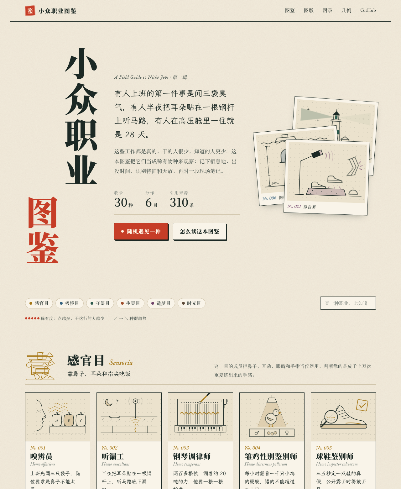
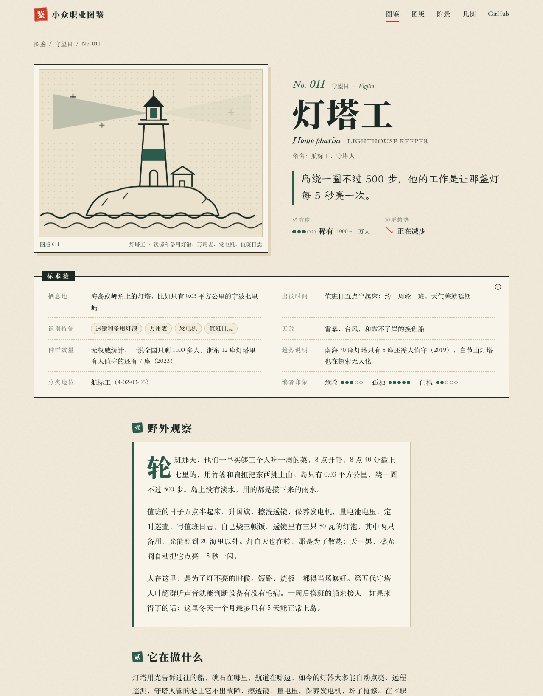

# 小众职业图鉴

**把冷门职业当成稀有物种来观察的野外手册。**

有人上班的第一件事是闻三袋臭气，有人半夜把耳朵贴在一根钢杆上听马路，有人在高压舱里一住就是 28 天。这些工作都是真的，干的人很少，知道的人更少。

这本图鉴借了博物图鉴的体例：每个职业一幅图版、一张标本签（栖息地、出没时间、识别特征、天敌、种群数量），再加一段现场笔记。把职业叫作“物种”是个玩笑，里面的事实不是，每一条都注明了来源。

**在线阅读：<https://digidai.github.io/niche-jobs-atlas/>**



## 第一辑收录

30 种职业，分成六个“目”。稀有度按全国从业人数的量级来分，点越多，干这行的人越少。

<!-- index:start -->

### 感官目　靠鼻子、耳朵和指尖吃饭

| No. | 职业 | 一句话 | 稀有度 | 条目 |
| :-: | :-- | :-- | :-: | :-: |
| 001 | [**嗅辨员**](https://digidai.github.io/niche-jobs-atlas/jobs/odor-panelist/)<br><sub>Odor Panelist</sub> | 上班先闻三只袋子，岗位要求是鼻子不能太灵。 | ●●○○○ | [原文](src/content/jobs/001-odor-panelist.md) |
| 002 | [**听漏工**](https://digidai.github.io/niche-jobs-atlas/jobs/leak-listener/)<br><sub>Leak Listener</sub> | 半夜把耳朵贴在一根钢杆上，听马路底下漏水。 | ●●●○○ | [原文](src/content/jobs/002-leak-listener.md) |
| 003 | [**钢琴调律师**](https://digidai.github.io/niche-jobs-atlas/jobs/piano-tuner/)<br><sub>Piano Tuner</sub> | 两百多根弦，绷着约 20 吨的力，他要一根一根拧准。 | ●●○○○ | [原文](src/content/jobs/003-piano-tuner.md) |
| 004 | [**雏鸡性别鉴别师**](https://digidai.github.io/niche-jobs-atlas/jobs/chick-sexer/)<br><sub>Chick Sexer</sub> | 每小时翻看一千只小鸡的屁股，错的不能超过二十只。 | ●●●○○ | [原文](src/content/jobs/004-chick-sexer.md) |
| 005 | [**球鞋鉴别师**](https://digidai.github.io/niche-jobs-atlas/jobs/sneaker-authenticator/)<br><sub>Sneaker Authenticator</sub> | 三五秒定一双鞋的真假，公开露面时得戴面具。 | ●●●○○ | [原文](src/content/jobs/005-sneaker-authenticator.md) |

### 极境目　上高空，下深海，钻进地底

| No. | 职业 | 一句话 | 稀有度 | 条目 |
| :-: | :-- | :-- | :-: | :-: |
| 006 | [**饱和潜水员**](https://digidai.github.io/niche-jobs-atlas/jobs/saturation-diver/)<br><sub>Saturation Diver</sub> | 住进高压舱近一个月，想出来得先减压十来天。 | ●●●●○ | [原文](src/content/jobs/006-saturation-diver.md) |
| 007 | [**管道潜水员**](https://digidai.github.io/niche-jobs-atlas/jobs/sewer-diver/)<br><sub>Sewer Diver</sub> | 穿六十多公斤的装具下到污水井里，全程靠手摸。 | ●●●○○ | [原文](src/content/jobs/007-sewer-diver.md) |
| 008 | [**塔吊司机**](https://digidai.github.io/niche-jobs-atlas/jobs/tower-crane-operator/)<br><sub>Tower Crane Operator</sub> | 上班先爬 70 多米的梯子，办公室不到 2 平方米。 | ●○○○○ | [原文](src/content/jobs/008-tower-crane-operator.md) |
| 009 | [**特高压带电作业工**](https://digidai.github.io/niche-jobs-atlas/jobs/live-line-worker/)<br><sub>UHV Live-Line Worker</sub> | 线路不停电，人穿着一身导电的衣服爬上百万伏的导线。 | ●●●●○ | [原文](src/content/jobs/009-live-line-worker.md) |
| 010 | [**引航员**](https://digidai.github.io/niche-jobs-atlas/jobs/marine-pilot/)<br><sub>Marine Pilot</sub> | 在浪尖上抓住软梯，爬上巨轮，把它引进港口。 | ●●●○○ | [原文](src/content/jobs/010-marine-pilot.md) |

### 守望目　守着一样东西过日子

| No. | 职业 | 一句话 | 稀有度 | 条目 |
| :-: | :-- | :-- | :-: | :-: |
| 011 | [**灯塔工**](https://digidai.github.io/niche-jobs-atlas/jobs/lighthouse-keeper/)<br><sub>Lighthouse Keeper</sub> | 岛绕一圈不过 500 步，他的工作是让那盏灯每 5 秒亮一次。 | ●●●○○ | [原文](src/content/jobs/011-lighthouse-keeper.md) |
| 012 | [**森林防火瞭望员**](https://digidai.github.io/niche-jobs-atlas/jobs/fire-lookout/)<br><sub>Fire Lookout</sub> | 每 15 分钟看一圈山，一天 96 次，本子上写得最多的是“无事”。 | ●●○○○ | [原文](src/content/jobs/012-fire-lookout.md) |
| 013 | [**守时人**](https://digidai.github.io/niche-jobs-atlas/jobs/timekeeper/)<br><sub>Timekeeper</sub> | “北京时间”不产自北京，产自西安临潼的一间地下室。 | ●●●●● | [原文](src/content/jobs/013-timekeeper.md) |
| 014 | [**机场驱鸟员**](https://digidai.github.io/niche-jobs-atlas/jobs/airport-bird-controller/)<br><sub>Airport Bird Controller</sub> | 首班飞机起飞前一小时上场，对手是鸟、虫、草，还有蝙蝠。 | ●●●○○ | [原文](src/content/jobs/014-airport-bird-controller.md) |
| 015 | [**人工增雨作业员**](https://digidai.github.io/niche-jobs-atlas/jobs/cloud-seeder/)<br><sub>Cloud Seeder</sub> | 朝云开炮之前，得先申请一小片天空，批下来只有几分钟。 | ●●○○○ | [原文](src/content/jobs/015-cloud-seeder.md) |

### 生灵目　同事不是人类

| No. | 职业 | 一句话 | 稀有度 | 条目 |
| :-: | :-- | :-- | :-: | :-: |
| 016 | [**修蹄师**](https://digidai.github.io/niche-jobs-atlas/jobs/hoof-trimmer/)<br><sub>Hoof Trimmer</sub> | 给一千斤重的奶牛修脚，一头十分钟，一天三十多头。 | ●●●●○ | [原文](src/content/jobs/016-hoof-trimmer.md) |
| 017 | [**蚊子饲养员**](https://digidai.github.io/niche-jobs-atlas/jobs/mosquito-rearer/)<br><sub>Mosquito Rearer</sub> | 每周养出几百万只蚊子，再亲手把它们放出去。 | ●●●●● | [原文](src/content/jobs/017-mosquito-rearer.md) |
| 018 | [**蛇毒采集员**](https://digidai.github.io/niche-jobs-atlas/jobs/snake-milker/)<br><sub>Snake Milker</sub> | 捏住毒蛇的头取毒，行内人说最难的一步是松手。 | ●●●●● | [原文](src/content/jobs/018-snake-milker.md) |
| 019 | [**导盲犬训练师**](https://digidai.github.io/niche-jobs-atlas/jobs/guide-dog-trainer/)<br><sub>Guide Dog Trainer</sub> | 把一只狗教到“该不听话时不听话”，然后亲手送走。 | ●●●●● | [原文](src/content/jobs/019-guide-dog-trainer.md) |
| 020 | [**宠物侦探**](https://digidai.github.io/niche-jobs-atlas/jobs/pet-detective/)<br><sub>Pet Detective</sub> | 找猫靠痕迹，找狗靠监控，开工时间是晚上十点。 | ●●●●○ | [原文](src/content/jobs/020-pet-detective.md) |

### 造梦目　作品人人见过，名字没人知道

| No. | 职业 | 一句话 | 稀有度 | 条目 |
| :-: | :-- | :-- | :-: | :-: |
| 021 | [**拟音师**](https://digidai.github.io/niche-jobs-atlas/jobs/foley-artist/)<br><sub>Foley Artist</sub> | 电影里的踩雪声，是他在地下室里揉一袋淀粉。 | ●●●●● | [原文](src/content/jobs/021-foley-artist.md) |
| 022 | [**动作捕捉演员**](https://digidai.github.io/niche-jobs-atlas/jobs/mocap-actor/)<br><sub>Motion Capture Actor</sub> | “天命人”的大部分动作是他演的，游戏里却没有他的脸。 | ●●●●○ | [原文](src/content/jobs/022-mocap-actor.md) |
| 023 | [**无障碍电影讲述人**](https://digidai.github.io/niche-jobs-atlas/jobs/audio-describer/)<br><sub>Audio Describer</sub> | 给看不见的人讲直升机：一只倒扣的汤勺，上面装着电风扇的扇叶。 | ●●●●● | [原文](src/content/jobs/023-audio-describer.md) |
| 024 | [**字体设计师**](https://digidai.github.io/niche-jobs-atlas/jobs/type-designer/)<br><sub>Type Designer</sub> | 你正在读的每一个字都是有人画出来的，一套至少 6763 个。 | ●●●●○ | [原文](src/content/jobs/024-type-designer.md) |
| 025 | [**职业美人鱼**](https://digidai.github.io/niche-jobs-atlas/jobs/professional-mermaid/)<br><sub>Professional Mermaid</sub> | 憋一口气潜到三米深，裸眼在 23 度的水里对你微笑。 | ●●●●○ | [原文](src/content/jobs/025-professional-mermaid.md) |

### 时光目　修补旧物，送别故人

| No. | 职业 | 一句话 | 稀有度 | 条目 |
| :-: | :-- | :-- | :-: | :-: |
| 026 | [**古籍修复师**](https://digidai.github.io/niche-jobs-atlas/jobs/book-conservator/)<br><sub>Rare Book Conservator</sub> | 破得厉害的书，一天修不完一页，而待修的古籍有一千多万册。 | ●●●○○ | [原文](src/content/jobs/026-book-conservator.md) |
| 027 | [**化石修理师**](https://digidai.github.io/niche-jobs-atlas/jobs/fossil-preparator/)<br><sub>Fossil Preparator</sub> | 在显微镜下剔石头，顺利的话，一天前进两三毫米。 | ●●●●○ | [原文](src/content/jobs/027-fossil-preparator.md) |
| 028 | [**遗物整理师**](https://digidai.github.io/niche-jobs-atlas/jobs/estate-organizer/)<br><sub>Estate Organizer</sub> | 进门先向遗像鞠躬，然后把一个人留下的东西一件一件登记下来。 | ●●●●● | [原文](src/content/jobs/028-estate-organizer.md) |
| 029 | [**遗体修复师**](https://digidai.github.io/niche-jobs-atlas/jobs/mortuary-restorer/)<br><sub>Mortuary Restorer</sub> | 目标是让逝者像他自己。家属说“不像”，就把梳好的头发重新弄乱。 | ●●●○○ | [原文](src/content/jobs/029-mortuary-restorer.md) |
| 030 | [**器官捐献协调员**](https://digidai.github.io/niche-jobs-atlas/jobs/organ-donation-coordinator/)<br><sub>Organ Donation Coordinator</sub> | 手机 24 小时开机，睡前把铃声调到最大。 | ●●●○○ | [原文](src/content/jobs/030-organ-donation-coordinator.md) |

<!-- index:end -->

另有三份附录：[伪物种辨析](https://digidai.github.io/niche-jobs-atlas/appendix/#pseudo)（企鹅扶正员、酒店试睡员、年薪百万的熊猫饲养员是真的吗）、[灭绝与新发现](https://digidai.github.io/niche-jobs-atlas/appendix/#red-list)、[待收录名单](https://digidai.github.io/niche-jobs-atlas/appendix/#backlog)。

## 一页长什么样



每个条目是一个 Markdown 文件，在 GitHub 上可以直接读，网站把它排成上面的样子。正文固定七节：

| 小节 | 写什么 |
| :-- | :-- |
| 野外观察 | 一段现场。时间、地点、数字和动作都来自公开报道，没有虚构的人物和对话 |
| 它在做什么 | 这份工作解决什么问题，为什么需要人来做 |
| 一次完整的作业 | 把一次典型的工作拆成几步 |
| 冷知识 | 查资料时让人停下来多看一眼的事实 |
| 常见误认 | 外界最常见的误会，以及实际情况 |
| 如何成为 | 入行路径、门槛、收入和难处 |
| 资料来源 | 这一页用到的全部来源 |

图版是手写的 SVG 线描，会动：灯塔的光在闪，塔吊的吊钩在晃，原子钟的秒针一格一格地走。全部图版见[图版一览](https://digidai.github.io/niche-jobs-atlas/plates/)。

## 资料是怎么核对的

- 每个条目先做调研笔记，逐条事实对应到实际打开读过的网页，优先用法规标准原文、主管部门和行业协会的发布、主流媒体的特稿和学术论文。
- 数字都带年份和口径。同一个数字有两种说法的，要么两个都写，要么不写。
- 带引号的话是来源里的原话，原样照录。
- 查不到的就写“查不到”“无统计”，不拿估计冒充事实。
- 每页底部标着最后核对的日期。第一辑的核对截止 2026 年 11 月 24 日。

错漏在所难免。发现问题，请[提一条勘误](https://github.com/Digidai/niche-jobs-atlas/issues/new/choose)并附上依据。

## 参与

你做着一份少有人知的工作，或者认识这样的人，欢迎补一条。三种参与方式：

1. **纠错**：哪个数字过时了，哪句话说得不对，提 issue 或直接改那一页。
2. **提名**：告诉我们还有什么职业值得写，最好附一个可靠的来源。
3. **写一条**：从[待收录名单](https://digidai.github.io/niche-jobs-atlas/appendix/#backlog)里认领，或者写你熟悉的职业。

写法、格式和核对要求见 [CONTRIBUTING.md](CONTRIBUTING.md)。

## 本地运行

需要 Node.js 22.23 以上（建议 24）。

```sh
npm install
npm run dev      # 本地预览，默认 http://localhost:4321/niche-jobs-atlas/
npm run build    # 构建到 dist/；条目格式不对会在这一步报错
npm run check    # 检查条目的编号、排版和腔调
npm run index    # 新增条目后，更新 README 里的收录目录
npm run fonts    # 新增条目后，重新裁剪中文字体子集
```

```text
src/content/jobs/   条目，一个职业一个 Markdown 文件
src/plates/         图版，一个职业一幅 SVG，文件名是图鉴编号
src/data/           六个“目”、图版说明、附录的数据
src/lib/entry.ts    把条目正文切成七节，顺带做格式检查
src/pages/          首页、条目页、图版一览、附录、凡例
src/styles/         全站样式
scripts/            字体子集、文字检查、README 目录
docs/               条目模板和截图
```

站点用 [Astro](https://astro.build/) 构建，推送到 `main` 之后由 GitHub Actions 部署到 GitHub Pages。fork 之后想部署到自己的地址，改 `astro.config.mjs` 里的 `site` 和 `base`。

## 许可

- 文字和图版（`src/content/`、`src/plates/`、`src/data/`）：[CC BY 4.0](LICENSE-CONTENT.md)。可以自由转载、改编，注明出处“小众职业图鉴”并附上链接即可。
- 代码：[MIT](LICENSE)。
- 字体：`src/assets/fonts/` 里是按网站用字裁出的子集，来自[思源宋体](https://github.com/notofonts/noto-cjk)、[霞鹜文楷](https://github.com/lxgw/LxgwWenKai)和 [IM Fell English](https://fonts.google.com/specimen/IM+Fell+English)，均为 SIL Open Font License 1.1。
- 条目引用的报道、标准和论文，版权归各自的作者和机构。
